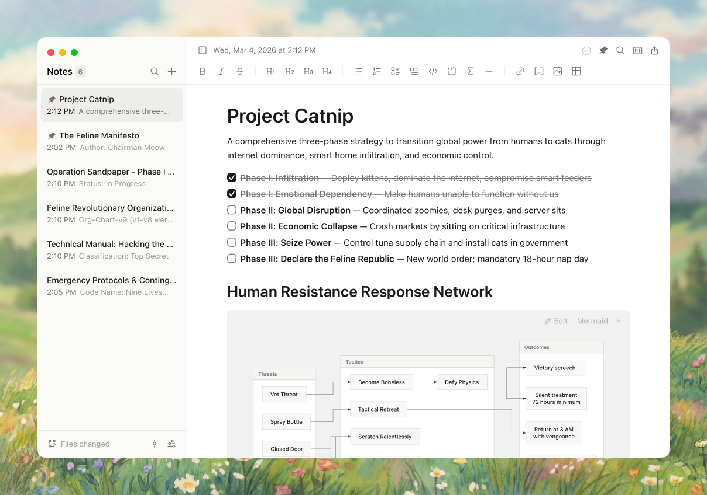

# Scratch

> [!NOTE]
> This is a fork of [erictli/scratch](https://github.com/erictli/scratch) that contains vibe-coded changes to the original project. They were built with AI assistance and are not part of the upstream app.
>
> **Changes in this fork:**
>
> - **Alphabetical notes in folders** - Notes inside folders are sorted A–Z (pinned notes stay on top; root-level notes keep newest-first order)
> - **Sidebar hover reveal** - When the sidebar is hidden, resting the pointer near the left edge of the note editor reveals it, just like the toggle button would. It hides again once the pointer moves away, with a short dwell time so quick movements out of the window don't trigger it
> - **Section path** - A bar above the note shows where you are as a breadcrumb of headings (`My big title / the story`), following the cursor after clicks or typing and the scroll position when scrolling. When it doesn't fit, the enclosing headings shorten first so the current one stays whole. A thin line along the bottom of the bar shows how far through the note you've read. Click the bar to expand an animated tree of all headings across the window and jump to one (Esc or a click elsewhere closes it). It replaces the heading indicator on the right edge and its setting. Hidden in source, focus and preview mode and in notes without headings
> - **Line numbers** - Optional line numbers in the editor (Settings → Editor: Off, Faint or Subtle), numbering each paragraph, heading and code line. Source mode numbers the real markdown lines, so the two can differ. The top bar shows the cursor's line as `x/max`. Hidden in focus mode
> - **Resizable table columns** - Drag a column edge to set its width. Widths are saved in the note as a hidden `<!-- table-widths: ... -->` comment above the table, since markdown tables can't hold them. Tables you haven't resized still size to their content
> - **Callouts** - Turn a passage into a colored callout from the toolbar or the `/` menu: Note, Info, Tip, Important, Definition, Example, Question, Summary, Exam, Warning, Caution, and Plain (gray, without a title). Saved as GitHub-style `> [!NOTE]` blockquotes, so they render as alerts on GitHub and as plain quotes elsewhere
> - **Inline math** - Typing `$` (or the Inline Math toolbar button) opens a popup that renders the formula live at the cursor as you type; press Space on the empty field for a literal `$`. Click inline math to edit it the same way. In saved notes `$x^2$` is inline math following the Pandoc rule (no space just inside the `$` signs, no digit right after the closing one), so prices like `$5 and $10` stay plain text
> - **Highlights** - Highlight text in yellow, green, blue, pink, or gray from the toolbar (`Cmd+Shift+H` for yellow). Yellow is saved as `==text==`, other colors as `<mark data-color="...">`
> - **Live reload of external edits** - When the open note changes on disk (e.g. edited by another app or an AI agent), it reloads automatically, keeping the cursor position. If you have unsaved edits, the Refresh button appears instead
> - **Filenames independent of content** - A note's filename is its title and no longer follows its first line. Rename a note from its right-click menu in the sidebar, or scroll up once more while at the top of a note to reveal the filename bar (`filename: <name>.md`, without the folder) over the section path (it stays until you scroll down). New notes open with the filename field focused
> - **Remembered positions** - Switching back to a note restores its scroll position and cursor. Positions are kept for 12 hours after you last left a note
> - **Tabs and windows** - Open a note in a new tab or window from its right-click menu (middle-click also opens a new tab). Clicking a note in the sidebar still replaces the current note, so the tab bar only shows up in the title bar once two or more tabs are open. `Cmd+T` new tab, `Cmd+W` closes the tab (or the window on the last one), `Ctrl+Tab` / `Ctrl+Shift+Tab` switch tabs, `Cmd+Shift+N` new window. Each tab returns to where you left it, and renames carry over to other windows
> - **Lower energy use** - The search index no longer writes to disk on every autosave or polls in the background, refreshing the note list only re-reads changed files, and typing no longer re-renders the whole editor
> - **Responsive with large notes** - Toolbar actions, math popups, menus, tooltips and the sidebar animation no longer stall when a long note is open, and switching back to a recently opened note skips re-parsing it. Dragging the page width handles stays smooth too
> - **Quieter toolbar** - The heading and list buttons are gone from the toolbar (use `Cmd+Alt+1`–`4`, `Cmd+Shift+7` / `8` or the `/` menu), and toolbar tooltips only appear after hovering for 2 seconds
> - **Cleaner window** - Vertical scrollbars are hidden (scrolling works as before), and in full screen the sidebar toggle and date move to the left edge, where the window buttons would be


A minimalist, offline-first markdown note-taking app for macOS, Windows, and Linux.

  

[Website](https://www.ericli.io/scratch) · [Releases](https://github.com/erictli/scratch/releases)

## Features

- **Offline-first** - No cloud, no account, no internet required
- **Markdown-based** - Notes stored as plain `.md` files you own
- **WYSIWYG editing** - Rich text editing that saves as markdown
- **Preview mode** - Open any `.md` file via drag-and-drop or "Open With" without a notes folder
- **Markdown source mode** - Toggle to view and edit raw markdown (`Cmd+Shift+M`)
- **Syntax highlighting** - 20 languages with GitHub-inspired color scheme
- **Mermaid diagrams** - Render flowcharts, sequence diagrams, and more in fenced code blocks
- **KaTeX math** - Inline `$...$` and block `$$...$$` math, edited in a popup with live preview (type `$` for inline math)
- **Callouts and highlights** - Colored GitHub-style callouts and multi-color text highlights
- **Resizable table columns** - Drag a column edge to set its width, saved in the note as a hidden comment
- **Wikilinks** - Type `[[` to link between notes with autocomplete
- **Slash commands** - Type `/` to quickly insert headings, lists, code blocks, diagrams, and more
- **Focus mode** - Distraction-free writing with animated sidebar/toolbar fade (`Cmd+Shift+Enter`)
- **Edit with Claude Code, OpenAI Codex, OpenCode, or Ollama** - Use your local CLI to edit notes with AI (including fully offline via Ollama)
- **Works with other AI agents** - Picks up external file changes automatically
- **Folders** - Opt-in collapsible folder tree with drag-and-drop to organize notes
- **Tabs and windows** - Open notes in tabs or in separate windows
- **Remembered positions** - Each note reopens at the scroll position and cursor where you left it, for 12 hours after you last left it
- **Filenames you control** - A note's filename is its title and never changes with its content; rename from the sidebar or the filename bar above the note
- **Section path** - A breadcrumb of the current heading above the note with a reading progress line, expandable to the full heading tree
- **Line numbers** - Optional, unobtrusive line numbers in the editor and in markdown source, plus a current line counter in the top bar
- **Keyboard optimized** - Lots of shortcuts and a command palette
- **Customizable** - Theme, typography, page width, and RTL text direction
- **Git integration** - Optional version control with push/pull for multi-device sync
- **Lightweight** - 5-10x smaller than Obsidian or Notion

## Screenshot



## Installation

### macOS

**Homebrew (Recommended)**

```bash
brew tap erictli/tap
brew install --cask erictli/tap/scratch
```

**Manual Download**

1. Download the latest `.dmg` from [Releases](https://github.com/erictli/scratch/releases)
2. Open the DMG and drag Scratch to Applications
3. Open Scratch from Applications

### Windows

Download the latest `.exe` installer from [Releases](https://github.com/erictli/scratch/releases) and run it. WebView2 will be downloaded automatically if needed.

### Linux

Download the latest `.AppImage` or `.deb` from [Releases](https://github.com/erictli/scratch/releases).

### From Source

**Prerequisites:** Node.js 18+, Rust 1.70+

**macOS:** Xcode Command Line Tools · **Windows:** WebView2 Runtime (pre-installed on Windows 11)

```bash
git clone https://github.com/erictli/scratch.git
cd scratch
npm install
npm run tauri dev      # Development
npm run tauri build    # Production build
```

## Keyboard Shortcuts

Scratch is designed to be usable without a mouse. Here are the essentials to get started:

| Shortcut          | Action                 |
| ----------------- | ---------------------- |
| `Cmd+N`           | New note               |
| `Cmd+T`           | New note in a new tab  |
| `Cmd+W`           | Close tab / window     |
| `Ctrl+Tab`        | Next tab               |
| `Ctrl+Shift+Tab`  | Previous tab           |
| `Cmd+Shift+N`     | New window             |
| `Cmd+D`           | Duplicate note         |
| `Delete`          | Delete note            |
| `Cmd+Backspace`   | Delete note            |
| `Cmd+P`           | Command palette        |
| `Cmd+K`           | Add/edit link          |
| `Cmd+F`           | Find in note           |
| `Cmd+Shift+C`     | Copy & Export menu     |
| `Cmd+Shift+M`     | Toggle Markdown source |
| `Cmd+Shift+Enter` | Toggle Focus mode      |
| `Cmd+Shift+F`     | Search notes           |
| `Cmd+R`           | Reload current note    |
| `Cmd+,`           | Open settings          |
| `Cmd+\`           | Toggle sidebar         |
| `Cmd+B/I`         | Bold/Italic            |
| `Cmd+Shift+H`     | Highlight              |
| `Cmd+Alt+1`–`4`   | Heading 1–4            |
| `Cmd+Shift+7/8`   | Numbered/Bullet list   |
| `Cmd+=/-/0`       | Zoom in/out/reset      |
| `↑/↓`             | Navigate notes         |

**Note:** On Windows, use `Ctrl` instead of `Cmd` for all shortcuts.

Many more shortcuts and features are available in the app—explore via the command palette (`Cmd+P` / `Ctrl+P`) or view the full reference in Settings → Shortcuts.

## Built With

[Tauri](https://tauri.app/) · [React](https://react.dev/) · [TipTap](https://tiptap.dev/) · [Tailwind CSS](https://tailwindcss.com/) · [Tantivy](https://github.com/quickwit-oss/tantivy)

## Contributing

Scratch is mostly stable and intentionally minimal, so I'm no longer monitoring issues and PRs regularly. You're welcome to open them, but I can't guarantee I'll get to everything, and it may take a while when I do.

What makes Scratch special is its minimal feature set and focus on user experience. We're not trying to build Obsidian or Notion, so not every feature will be a fit. If you want to make major changes or take Scratch in a new direction, you should fork it – it's MIT licensed.

**If you open a PR:** keep it small and focused, and try to address any CodeRabbit comments. I generally won't go back and forth with review comments – if I merge, I'll make any additional changes directly.

## License

MIT
